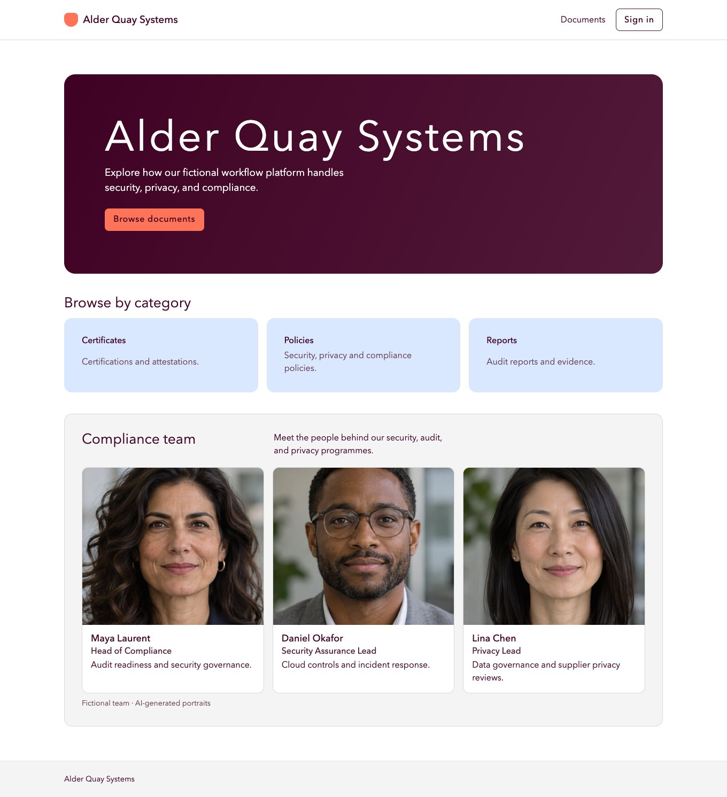
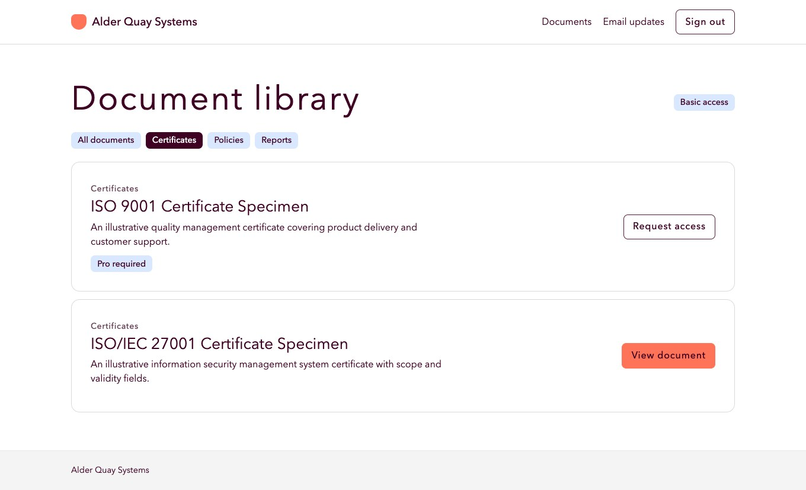
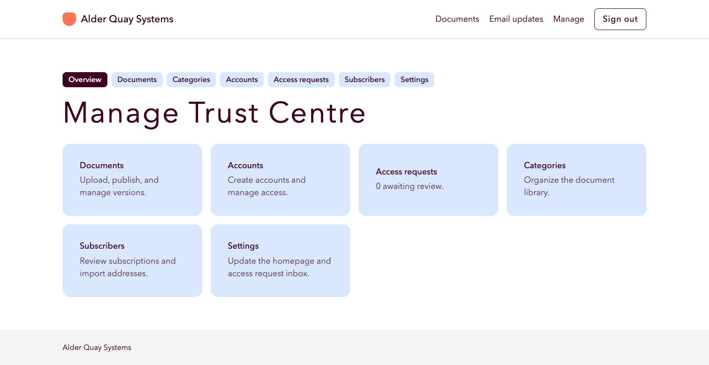

# Trust Centre — Self-hosted compliance document portal

A self-hosted portal for compliance reports, certificates and policies. It uses Flask, SQLite, private PDF storage and SMTP. The customer interface is rendered on the server and uses a small script for the agreement dialog.

## Run behind a reverse proxy

You need Git, Docker Engine with Compose, a public HTTPS hostname, and an SMTP service reachable from the containers. For a private repository, give the deployment server read access before cloning. A repository deploy key is sufficient. [GitHub deploy-key guide](https://docs.github.com/en/authentication/connecting-to-github-with-ssh/managing-deploy-keys)

From the repository root:

1. Copy `.env.example` to `.env` and run `chmod 600 .env`. Generate a secret with `openssl rand -hex 48` and set `SECRET_KEY`. Set `BASE_URL` to your HTTPS origin, with no path. Set `PORTAL_PORT` if port 8000 is already in use.
2. Configure `SMTP_HOST`, `SMTP_PORT`, and `FROM_EMAIL`, plus `SMTP_USER` and `SMTP_PASSWORD` if your server requires authentication. For submission on port 587, use `SMTP_TLS=1` and `SMTP_SSL=0`. If SMTP runs on the Docker host, use a hostname that the containers can reach and that matches its TLS certificate.
3. Build and start both services.

   ```sh
   docker compose build web
   docker compose up -d --pull never
   docker compose ps
   ```

4. Configure your HTTPS reverse proxy to point to the selected loopback port. Once the web service is running, create your first Owner and enrol their authenticator.

   ```sh
   docker compose exec web python manage.py createsuperuser
   docker compose exec web python manage.py enable_totp YOUR_USERNAME
   ```

   Add the private setup URI to an authenticator that accepts TOTP links, or enter its secret manually. The same command resets a lost authenticator.

Example Nginx directives inside the HTTPS virtual host:

```nginx
client_max_body_size 27m;
location / {
    proxy_pass http://127.0.0.1:8000;
    proxy_set_header Host $host;
    proxy_set_header X-Forwarded-Proto $scheme;
    proxy_set_header X-Real-IP $remote_addr;
}
```

Redirect HTTP to HTTPS at the proxy. Keep the web service private behind the proxy, overwrite the forwarded headers as shown, and keep proxy caching disabled. The application trusts these headers for HTTPS and sign-in throttling. Run one web worker and one mail worker per installation.

The Docker container names are `trust-portal-<project>-web` and `trust-portal-<project>-mail`. Use a distinct Compose project name for each new installation on the same host. Keep the project name of an existing installation to reuse its data volume and network. The Compose service names are still `web` and `mail`.

## Manage the portal

Open `/manage/` or select **Manage** in the main navigation. Admins and Owners enter their password and authenticator code during sign-in. Their verified session opens Manage directly.

| Screen | What you can do |
| --- | --- |
| **Overview** | Open common management tasks and see how many access requests are awaiting review. |
| **Documents** | Add a PDF with a category, public teaser, minimum access level, and optional agreement. Preview the uploaded draft, then choose **Publish** under **Versions**. Upload replacements from the same page, restore a retained version, or review recorded agreement acceptances. |
| **Categories** | Add and edit the categories used by the public library. Move documents out of a category before deleting it. |
| **Accounts** | Review account requests, import customers from CSV, create customers, assign access levels, enable or disable accounts, send password resets, and delete accounts. Higher customer tiers include lower tiers. Only Owners can manage administrator accounts. After granting administrator access, use `enable_totp` to enrol that administrator. |
| **Access requests** | Review a request, open the customer account to update their tier, and mark the request handled. The portal also emails the inbox configured in Settings. |
| **Subscribers** | Review subscription status and import a UTF-8 CSV with an `email` column. New recipients receive a confirmation link. |
| **Settings** | Edit homepage copy, team description, logo URL, colours, font, and the access-request inbox. Use **Manage webfonts** to configure or add a webfont. |

Category descriptions, document titles, and teasers are public. Publishing or restoring a version emails confirmed subscribers. Document links still require the appropriate access tier and, where enabled, agreement acceptance. The portal uses local accounts and manual access grants.

To verify a new installation, publish a sample PDF and try it with a customer account. Check the teaser and access request at a lower tier, agreement acceptance after granting access, and delivery of a password reset and a document update.

## Onboard customers

From **Sign in → Request an account**, a customer supplies their work email and customer or company name. Open **Manage → Accounts → Account requests** to match the request to your customer records, select an access level, and approve or decline it.

For bulk onboarding, open **Manage → Accounts → Import accounts** and upload a UTF-8 CSV. The `email` column is required. `company` and `tier` are optional. The tier can be Basic, Pro, or Expert and defaults to Basic.

```csv
email,company,tier
sam@example.com,Example Company,Pro
```

Imported entries go to the same approval list. Select one or more requests and choose **Approve and send setup email**. Approval queues an email with the username and a password setup link. The link expires one hour after generation. If it expires, use **Forgot your password?** or send another link from the account page. Use **Access requests** for existing customers who need a higher tier for a document.

## Try the fictional demo

On a fresh installation, run `docker compose exec web python manage.py seed_demo` after the web service starts. For local development, run `python manage.py seed_demo` after running `python manage.py init_db`. The command loads the Alder Quay Systems homepage with three fictional compliance team profiles and AI-generated portraits. It also publishes two sample PDFs each under Reports, Certificates, and Policies, with a mix of Basic, Pro, and Expert access. The SOC 2 report preview demonstrates the agreement dialog.

Use a separate demo data volume if you also run a real portal. The demo command refuses a database that already has branding or documents and creates no accounts or notification emails. The original PDFs live in `output/pdf/`; the certificate specimens and audit report are clearly marked as fictional.

## Screenshots

Captured from a local Trust Centre using the fictional Alder Quay Systems demo.

### Homepage



### Document library



### Manage dashboard



## Upgrade from the previous Django version

Back up the database and private files together before updating. Keep the existing Compose project name, data volume, `.env`, and any local Compose override. The Flask app uses the existing SQLite records and private PDFs in place. Existing passwords, authenticator enrolments, document revisions, agreements, subscribers, and queued mail carry forward. Users must sign in again and request fresh links for any outstanding password resets. The first startup also works on an empty volume.

## Maintain

- Back up the `portal-data` volume, including `portal.sqlite3` and the `private/` PDFs. Stop both services before taking or restoring a filesystem backup so database and files represent the same point in time. Preserve the `.env` separately.
- Run `./update.sh` from your deployment checkout after backing up. If the checkout predates the script, first run `git pull --ff-only origin main`. The script fast-forwards `main`, rebuilds the image shared by web and mail, restarts the services as needed, and shows their status. The web container initializes the database on startup.
- Check password reset delivery with `docker compose logs --tail=50 web`. Access requests and subscriber notifications use the mail worker. Check those with `docker compose logs --tail=50 mail`. Queued mail retries with backoff. Request a fresh password reset after correcting SMTP settings.
- Keep the app's data volume off the public web root. Serve only the app's static assets directly.

## Local development

```sh
python3 -m venv .venv
. .venv/bin/activate
pip install -r requirements.txt
export DEBUG=1 MAIL_CONSOLE=1
python manage.py init_db
python manage.py createsuperuser
python manage.py enable_totp YOUR_USERNAME
python manage.py run --host localhost --port 8000
```

Run `python manage.py send_queue --watch` in another shell with the same environment to see queued messages in its console.

Run `DEBUG=1 python -m unittest portal.tests` for the focused workflow checks.

## Webfonts

Chromatica is the default. To use it on devices without a local copy, open **Manage → Settings → Manage webfonts → Chromatica** and enter URLs for your licensed WOFF2 files. Regular and Medium are the primary weights. You can also supply the matching oblique files. Fonts served from another domain must allow cross-origin requests from the portal. The system fallback is used until the files are available.

To add another font family, use **Add webfont**, supply at least the Regular WOFF2 URL, and select the family in **Portal settings**. The system sans, serif, and mono choices are also available.

## License

The project is licensed under the [MIT License](LICENSE). Obtain your own webfont license for any commercial typeface you configure.
